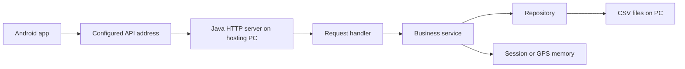

# How the current server works

This guide describes the active implementation reviewed on November 17, 2026. It follows the code registered by `ShuttleServer.start()`, rather than treating every helper class or older README feature as an active server feature.

The backend is a Java HTTP API running on the hosting computer. The Android APK supplies the user interface. Persistent worker, vehicle, shift, and schedule records are stored as CSV files on that computer. Login sessions and the latest GPS positions are held in server memory.

The Android client and server exchange CSV requests and responses. Section 12 describes how location uploads and trip records are encoded.

## 1. Components and request path

| Component | Responsibility |
| --- | --- |
| `app` | Android screens, login client, GPS collection, offline queue, and network calls. |
| `common` | Shared Java domain classes such as Worker, Driver, Operator, ShuttleUnit, and ShiftRecord. |
| `server-backend` | JDK HTTP server, authentication, request handlers, business services, and CSV repositories. |
| Hosting scripts | Build/start the backend and optionally connect a public HTTPS tunnel. |



When the configured address is an HTTPS tunnel, the tunnel forwards requests to the local HTTP server. It provides connectivity; application processing and CSV storage still happen on the hosting PC. The server itself creates a plain `HttpServer`, not an HTTPS server.

The backend build depends on `common` and uses JDK facilities, including `com.sun.net.httpserver`, rather than a server framework or database driver. The Gradle `run` task and PC hosting scripts use the repository root as the working directory, making their relative data paths consistent.

Sources: [backend build](../server-backend/build.gradle), [ShuttleServer](../server-backend/src/main/java/com/shuttle/server/ShuttleServer.java), [hosting instructions](PC_HOSTING.md).

## 2. Startup sequence

1. The Java process enters `ServerMain.main()`.
2. `ServerMain` constructs `ShuttleServer` and calls `start()`.
3. `ShuttleServer.start()` calls `Repositories.init()` before accepting requests.
4. Initialization obtains paths from `ServerConfig`, creates parent directories, and constructs the worker, shuttle, shift, and schedule repositories.
5. Each repository loads and validates its CSV records into an in-memory collection. If its file is missing, it creates an empty CSV table with the required header.
6. The server reads its configured port, which defaults to `8080`.
7. It binds a JDK HTTP server to a wildcard network address, then assigns a fixed pool of ten request-processing threads.
8. It registers the API contexts listed in section 4 and starts listening.
9. `ServerMain` checks whether the worker repository is empty. If so, it prints a message explaining that the first account can be registered from the app.

`ServerConfig` looks for `config.properties` as a classpath resource. Its supported properties are `server.port`, `csv.workers`, `csv.shuttles`, `csv.shifts`, and `csv.schedule`. The active code does not read these values from environment variables such as `PORT` or `DATABASE_URL`.

The default paths are:

| Records | Default path |
| --- | --- |
| Workers and password hashes | `sample-data/import/workers.txt` |
| Vehicles | `sample-data/import/shuttles.txt` |
| Shifts | `sample-data/import/shifts.txt` |
| Work schedules | `sample-data/import/schedule.txt` |

Unless explicitly configured, the shift and schedule files are resolved beside workers.txt. Invalid repository data can prevent startup because repositories are initialized before the HTTP listener starts. `ServerMain` logs startup exceptions and prints their stack traces.

Sources: [ServerMain](../server-backend/src/main/java/com/shuttle/server/ServerMain.java), [ServerConfig](../server-backend/src/main/java/com/shuttle/server/ServerConfig.java), [Repositories](../server-backend/src/main/java/com/shuttle/server/Repositories.java).

## 3. What happens to an incoming request

Most registered endpoints extend `BaseHandler` and use this sequence:

1. The HTTP server selects a handler using its registered path context.
2. `BaseHandler.readRequest()` reads the method, splits the URL path, removes the leading `api` segment, and decodes query parameters.
3. For POST, PUT, PATCH, and DELETE requests, it reads a nonempty body as UTF-8 and passes it to `Csv.parseRows()`.
4. The first CSV row becomes `r.body`. The complete list becomes `r.rows`, which is used for operations such as replacing a schedule.
5. `ApiHandler.extractToken()` reads the Authorization header. Normal clients send `Authorization: Bearer <session-token>`; the extractor also accepts a raw token value.
6. Unless that handler marks the request public, `ApiHandler.requireAuth()` validates the token against the in-memory session map.
7. The handler selects the requested action, applies permission checks, and calls its service.
8. The service reads repositories, performs validation, and updates memory or persistent records as required.
9. The handler returns a response status and a Java object or list. `BaseHandler` converts the result through `Csv.toCsv()`.
10. `ApiHandler.sendResponse()` writes the response with `Content-Type: text/csv; charset=utf-8`.

The health check and unmatched `/api` fallback are direct handler lambdas rather than BaseHandler subclasses. They also use the CSV response helper.

Changing an Accept or Content-Type header to application/json does not change the registered server's parser or serializer: the active path still reads and writes CSV.

### Error handling

| Condition | Response behavior |
| --- | --- |
| Explicit `ApiException` | Uses its HTTP status and an `error` CSV row. |
| `IllegalArgumentException` | HTTP 400 with an error message. |
| `IllegalStateException` | HTTP 409 with an error message. |
| Unexpected exception | Logs the failure and returns HTTP 500 with a generic server-error message. |

Individual handlers also produce statuses such as 401 for an invalid session, 403 for forbidden operations, 404 for missing resources, and 405 for unsupported methods. Successful reads and updates generally return 200; successful creations generally return 201.

Sources: [BaseHandler](../server-backend/src/main/java/com/shuttle/server/handler/BaseHandler.java), [ApiHandler](../server-backend/src/main/java/com/shuttle/server/handler/ApiHandler.java), [Csv](../server-backend/src/main/java/com/shuttle/server/Csv.java).

## 4. Registered API operations

| Path | Implemented operations and access |
| --- | --- |
| `/api/health` | Public health response. Normally tested with GET. The lambda itself does not restrict the HTTP method. |
| `/api/auth` | POST to the base path or `/login` authenticates; POST `/register` creates/completes an account. POST `/logout` and GET `/me` require a session. |
| `/api/workers` | Operator-only list and pending-worker creation. Profile reads/updates and status changes allow the relevant worker or an Operator. Deletion and assignment require an Operator. |
| `/api/shift` | Driver-only POST `/start` and `/end`. Active shift, history, and individual-shift reads are filtered by the user's role and identity. |
| `/api/location` | Authenticated POST for a position update. A Driver's assigned vehicle is selected by the server. |
| `/api/live` | Authenticated GET of registered shuttles with a recorded position; normally restricted to IN_SERVICE vehicles. `?all=true` includes other vehicle statuses. |
| `/api/shuttles` | Authenticated list and detail reads. Operator-only creation, deletion, and status changes. Authenticated POST `/{id}/location`, with Drivers restricted to their assigned vehicle. |
| `/api/dashboard` | Operator-only GET of aggregate counts. |
| `/api/schedule` | Authenticated GET. Operator-only PUT replaces the schedule from a CSV table. |

The current role enum contains DRIVER and OPERATOR. There are no separate Admin or Dispatcher roles in this active implementation.

The root path `/` has no browser page and returns 404. Unmatched API paths are handled by the registered `/api` fallback and return an endpoint-not-found response. The Android app is the user interface.

Source: [ShuttleServer route registration](../server-backend/src/main/java/com/shuttle/server/ShuttleServer.java), [Role](../common/src/main/java/com/shuttle/common/Role.java), and the corresponding [handlers](../server-backend/src/main/java/com/shuttle/server/handler).

## 5. Registration, login, and sessions

### Registration

1. The client POSTs a CSV row to `/api/auth/register` containing the selected role, name, email, phone, password, and any supported optional fields.
2. `RegistrationService` normalizes the role. A missing role defaults to DRIVER; valid explicit roles are DRIVER and OPERATOR.
3. `WorkerService.register()` validates the name, phone, email, password length, and relevant uniqueness constraints.
4. If a pending worker with the same phone and role exists, registration completes that existing worker. Otherwise, a new worker is created with a generated or supplied employee ID.
5. `Crypto.hashPassword()` creates a fresh 16-byte random salt and derives a 256-bit hash using PBKDF2WithHmacSHA256 with 120,000 iterations. The stored value includes the algorithm marker, iteration count, salt, and derived hash.
6. The worker repository writes the updated workers.txt.
7. The handler authenticates the new account and returns HTTP 201 with a token and public worker fields. The password hash is excluded from those public fields.

An Operator can also create a pending worker through POST `/api/workers`. That record uses a PENDING password marker and a placeholder email until the worker completes registration.

The current public registration path accepts OPERATOR directly. It is not gated by a registered invite endpoint or a first-account-only check.

### Login

1. The client sends email/password or phone/password to `/api/auth/login`.
2. `Auth` looks up the worker and verifies the submitted password against the stored hash. The verifier also supports an older hash format for compatibility.
3. Login rejects a worker whose employment status is present and is not ACTIVE.
4. A successful login generates a UUID token and saves `token -> employeeId` in `Auth.activeSessions`, a ConcurrentHashMap.
5. The response contains the token and public worker fields.
6. Android's `AuthApi` parses this CSV response, stores the session in the static `Session` class, and supplies the token to `ApiClient`.

Later protected requests identify the worker through the token. Logout removes the token. Removing a worker also invalidates that worker's sessions. Sessions have no configured expiration timer and are lost when the server process restarts. Android's static Session is also an in-memory client object.

Example login request body:

```csv
email,password
driver@example.com,example-password
```

Sources: [AuthHandler](../server-backend/src/main/java/com/shuttle/server/handler/AuthHandler.java), [RegistrationService](../server-backend/src/main/java/com/shuttle/server/service/RegistrationService.java), [WorkerService](../server-backend/src/main/java/com/shuttle/server/service/WorkerService.java), [Auth](../server-backend/src/main/java/com/shuttle/server/Auth.java), [Crypto](../server-backend/src/main/java/com/shuttle/server/Crypto.java), [AuthApi](../app/src/main/java/com/shuttle/mobile/ui/AuthApi.java), [Session](../app/src/main/java/com/shuttle/mobile/ui/Session.java).

## 6. Operator setup and management

Operators manage workers and vehicles through their handlers and services. For example, an Operator can add a vehicle with a unique shuttle ID, a plate number, and positive capacity. New vehicles start AVAILABLE.

Assignment updates save a Driver's assigned shuttle and terminal in workers.txt. The service verifies a supplied shuttle ID exists and rejects changing the vehicle while the Driver has an active shift ID. Operator assignments use fields such as terminal zone and shift time.

Worker status updates support ON_SHIFT, ON_BREAK, and OFF_SHIFT. Drivers need an active shift to move to an on-shift or break state, and must end their shift before going off duty.

An Operator cannot delete their own account through WorkerHandler. Removing a Driver with an active shift calls `ShiftService.forceClose(..., "TIMED_OUT")`, invalidates sessions, removes schedule entries, and deletes the worker record.

Schedule replacement validates employee IDs. Each schedule entry has a shift index of 0, 1, or 2 and a seven-character Monday-first 0/1 day pattern. The PUT operation replaces the stored schedule rather than patching a single row.

Sources: [WorkerHandler](../server-backend/src/main/java/com/shuttle/server/handler/WorkerHandler.java), [WorkerService](../server-backend/src/main/java/com/shuttle/server/service/WorkerService.java), [FleetService](../server-backend/src/main/java/com/shuttle/server/service/FleetService.java), [ReportService](../server-backend/src/main/java/com/shuttle/server/service/ReportService.java), [ScheduleRepository](../server-backend/src/main/java/com/shuttle/server/repository/ScheduleRepository.java).

## 7. Starting a Driver's shift

Given an authenticated Driver request to POST `/api/shift/start`, ShiftHandler calls ShiftService.start(). Under the shared repository lock, the service checks:

1. The worker is a Driver and still exists.
2. Neither the Driver's active-shift field nor the shift repository already identifies a running shift for that Driver.
3. A vehicle is assigned and still exists.
4. The vehicle is not MAINTENANCE or OFFLINE.
5. Another active shift is not already using that vehicle.

It then generates a shift ID, records the Driver, vehicle, terminal, server start time, ACTIVE status, and an unset end time. It saves the shift, records the active shift ID and ON_SHIFT status on the Driver, and changes the vehicle status to IN_SERVICE.

These changes are written to shifts.txt, workers.txt, and shuttles.txt. The service logs the event and returns the shift fields with HTTP 201.

The shared lock serializes coordinated service changes within this Java process. The three CSV writes are separate writes; this is not a multi-file database transaction with automatic rollback.

Sources: [ShiftHandler](../server-backend/src/main/java/com/shuttle/server/handler/ShiftHandler.java), [ShiftService](../server-backend/src/main/java/com/shuttle/server/service/ShiftService.java).

## 8. GPS collection and server position handling

### Phone-side collection and retry

GpsTrackerService is an Android foreground service with a visible notification. With location permission, it requests high-accuracy locations at an approximately five-second interval, with a two-second minimum update interval. Actual timing depends on Android and the location provider. The service subscribes to the fused location provider for the active shift.

RouteRepository writes timestamped fixes, speed and optional bearing to an app-private SQLite database before scheduling telemetry uploads. The driver card observes immutable LiveMapUiState snapshots through LiveData. Each snapshot links to earlier fixes so a resumed screen can draw the points it missed. The database retains the current or last completed route for each server and driver.

Before sending the newest update, it tries to flush older queued updates in order. Failed/retryable sends are kept in the app-private offline_queue.txt file. The queue holds up to 1,000 entries and drops the oldest when that maximum is exceeded. Retry is triggered by later GPS callbacks; the server does not read the phone's queue directly.

### Server-side validation

The server supports POST `/api/location` and POST `/api/shuttles/{id}/location`. With the second route, a Driver can report only for their assigned vehicle. The first route selects the Driver's assigned vehicle itself. Operators can provide a vehicle ID.

The handler requires latitude and longitude fields, then calls TrackingService.updateLocation(). For a correctly formatted request, the service:

1. Requires a nonempty shuttle ID and valid coordinate ranges.
2. Uses the supplied positive device timestamp, or the server's current time when the timestamp is absent or nonpositive.
3. Rejects a device time more than five minutes in the future.
4. Ignores an update whose timestamp is not newer than the stored position for that shuttle.
5. Computes distance and elapsed time against the previous position. When the elapsed time is at least two seconds, it rejects a calculated movement speed above 160 km/h.
6. Stores the latest accepted Position in an in-memory ConcurrentHashMap, including coordinates, reported speed converted from metres/second to km/h, device time, and server receipt time.

These location handlers do not themselves require an active shift. Their Driver restriction is based on vehicle assignment. An ignored old update still reaches the handler's normal success response.

A server restart clears the in-memory live positions. Android sends location fields as CSV and retains the shift trail on the phone.

Example CSV body for a correctly formatted location request:

```csv
latitude,longitude,speed,timestamp
14.5995,120.9842,5.0,0
```

In this example, speed is 5 metres/second and timestamp 0 asks the service to use its receipt-time clock.

Sources: [GpsTrackerService](../app/src/main/java/com/shuttle/mobile/gps/GpsTrackerService.java), [OfflineQueueManager](../app/src/main/java/com/shuttle/mobile/client/OfflineQueueManager.java), [ApiClient](../app/src/main/java/com/shuttle/mobile/client/ApiClient.java), [LocationHandler](../server-backend/src/main/java/com/shuttle/server/handler/LocationHandler.java), [ShuttleLocationHandler](../server-backend/src/main/java/com/shuttle/server/handler/ShuttleLocationHandler.java), [TrackingService](../server-backend/src/main/java/com/shuttle/server/service/TrackingService.java).

## 9. Reading fleet information, dashboards, and history

FleetService combines persistent shuttle records with active shift records, Driver identity, and the latest in-memory position. It returns position time and ageSeconds so clients can evaluate how old a recorded position is.

GET `/api/live` normally returns registered vehicles that have a recorded position and are IN_SERVICE. With `all=true`, it includes other vehicle statuses that have positions. There is no automatic age-based removal in this handler; an old position can remain until replaced or the server restarts.

Dashboard counts are computed when an Operator requests them. These include vehicle-status counts, worker-status counts, active shifts, and finished shifts. In particular, staff on duty is derived from stored ON_SHIFT status, rather than a live network-presence check.

History requests return repository shift records. Drivers are restricted to their own shifts, while Operators can request broader history or select a Driver. The registered handlers answer ordinary HTTP requests; there is no WebSocket or server-push implementation in this request path.

Sources: [FleetService](../server-backend/src/main/java/com/shuttle/server/service/FleetService.java), [LiveHandler](../server-backend/src/main/java/com/shuttle/server/handler/LiveHandler.java), [ReportService](../server-backend/src/main/java/com/shuttle/server/service/ReportService.java), [ShiftHandler](../server-backend/src/main/java/com/shuttle/server/handler/ShiftHandler.java).

## 10. Ending a shift

POST `/api/shift/end` requires a Driver session. A request with a shift ID can close only that driver's matching shift. Retrying an acknowledged end returns the saved trip, including when the driver has already started another shift.

The client sends the locally recorded end time, distance, stops and full route. The server accepts route strings up to 2 MiB and returns HTTP 413 for larger payloads. Older clients can omit the shift ID and end time to end their current shift.

The service records an end time no earlier than the shift start, changes the shift to COMPLETED, and persists its summary. It clears the Driver's active shift ID and sets OFF_SHIFT. If the vehicle is still IN_SERVICE, it changes it to AVAILABLE. The response includes duration and average speed computed from the shift record.

End Shift freezes the trail locally, stops GPS collection and fits the whole route in the card. The driver screen retries a pending upload while open and when reopened. The Fleet tab requests shift summaries without geometry and fetches the route when a trip is opened.

Sources: [ShiftService](../server-backend/src/main/java/com/shuttle/server/service/ShiftService.java), [ShiftRepository](../server-backend/src/main/java/com/shuttle/server/repository/ShiftRepository.java), [DriverActivity](../app/src/main/java/com/shuttle/mobile/ui/DriverActivity.java).

## 11. Saving records and restarting

Repository reads normally use in-memory collections loaded at startup. Repository methods use read/write locks and copy records to prevent callers from directly changing the cached data without a save.

For a typical save, the repository validates a proposed record, constructs its next collection, writes a complete CSV table, and publishes that collection as its new in-memory state after the write succeeds.

CsvTable delegates the disk write to AtomicFileWriter:

1. Normalize the target path and create its directory.
2. Acquire a per-file JVM lock.
3. Lock a separate `.lock` file through FileChannel.
4. Write the complete UTF-8 CSV to a `.tmp` file.
5. Force the temporary file's contents to disk.
6. Attempt an atomic move to the target; use a replacement move if atomic moves are unsupported.
7. Clean up the temporary file and release the locks.

The file-level locking and swaps protect individual writes. They do not make several repository files one atomic transaction or turn separately running server processes into a shared database. Manual edits to CSV files are not automatically watched and reloaded by the active request path.

| State | Storage | After a server restart |
| --- | --- | --- |
| Workers, password hashes, and assignments | workers.txt | Loaded again. |
| Vehicles and stored statuses | shuttles.txt | Loaded again. |
| Active/completed shift records and saved trip summaries | shifts.txt | Loaded again, including records still marked ACTIVE. |
| Work schedules | schedule.txt | Loaded again. |
| Login tokens | Auth.activeSessions in memory | Cleared; clients need a new login. |
| Latest live positions | TrackingService.positions in memory | Cleared; new accepted GPS updates are needed. |
| Offline GPS queue | Android app-private file | Independent of a backend restart; retained until handled, dropped by the queue limit, or cleared. |
| Selected server log events | server.log on the hosting PC | Existing file content remains. |

Log writes append timestamped INFO, ERROR, and AUDIT messages to console output and server.log. This is an ordinary append-written text file, not a cryptographically tamper-proof log or a complete journal of every HTTP request.

Sources: [WorkerRepository](../server-backend/src/main/java/com/shuttle/server/repository/WorkerRepository.java), [ShiftRepository](../server-backend/src/main/java/com/shuttle/server/repository/ShiftRepository.java), [ShuttleRepository](../server-backend/src/main/java/com/shuttle/server/repository/ShuttleRepository.java), [ScheduleRepository](../server-backend/src/main/java/com/shuttle/server/repository/ScheduleRepository.java), [CsvTable](../server-backend/src/main/java/com/shuttle/server/io/CsvTable.java), [AtomicFileWriter](../server-backend/src/main/java/com/shuttle/server/io/AtomicFileWriter.java), [Log](../server-backend/src/main/java/com/shuttle/server/Log.java).

## 12. Android and server data formats

FleetApi converts the driver's shift requests to CSV and parses the server's CSV rows into the JSON objects consumed by the screens. The active-shift endpoint returns zero or one row. An empty table means the driver is off duty.

ApiClient queues location fields locally as JSON and converts them to CSV before uploading. The completed route uses the existing semicolon-separated latitude/longitude pairs in a quoted CSV field. A driver can reopen trips saved by earlier app versions.

Sources: [BaseHandler](../server-backend/src/main/java/com/shuttle/server/handler/BaseHandler.java), [ApiHandler](../server-backend/src/main/java/com/shuttle/server/handler/ApiHandler.java), [AuthApi](../app/src/main/java/com/shuttle/mobile/ui/AuthApi.java), [FleetApi](../app/src/main/java/com/shuttle/mobile/ui/FleetApi.java), [ApiClient](../app/src/main/java/com/shuttle/mobile/client/ApiClient.java).

## 13. Helper code that is not part of the active startup flow

| Existing class or earlier feature description | Current active behavior |
| --- | --- |
| InviteHandler / InviteService / InviteRepository | InviteHandler is not registered by ShuttleServer, and Repositories does not initialize an InviteRepository. Normal registration goes through `/api/auth/register`. |
| ImportService / ExportService | Helper implementations exist, but the current server startup and registered handlers do not invoke their company-data import/export or backup workflows. Repositories directly load their configured CSV files. |
| RateLimiter | The class exists, but the active handlers and Auth do not call it. |
| Heartbeat-based automatic shift closure | No scheduler or heartbeat monitor is started by the current server. Driver removal can force-close a shift; losing network access does not itself trigger a scheduled closure here. |
| Bootstrap-admin command-line arguments | ServerMain accepts the args array but does not process it. Current startup prints a registration message when there are no accounts. |
| Server-side historical GPS archive | TrackingService keeps only the latest position per vehicle in memory. A submitted completed-shift route can be saved with the shift summary. |
| Permanent endpoint or automatic address discovery | The Android code uses a compiled ApiClient.BASE_URL. The existing Cloudflare starter edits that constant and can rebuild the APK. The discussed discovery and permanent-address alternatives have not been implemented in this server process. |

This distinction is important when describing the system: the presence of a Java class alone does not establish that the running server calls it.

## Process summary

The current server starts a JDK HTTP listener on the hosting PC after loading its CSV repositories. Incoming CSV API requests are authenticated with in-memory session tokens and routed to role-aware handlers. Business services manage worker assignments, vehicle availability, schedules, and shift records, persisting changes through locked CSV writes. Accepted location updates replace the latest in-memory position for each vehicle, which fleet reads combine with stored vehicle and shift information. Completed-shift summaries are saved to disk. After a backend restart, persistent records reload, while login sessions and live positions must be recreated. Public HTTPS tunneling changes how clients reach this process, while application execution and storage remain on the hosting PC.
